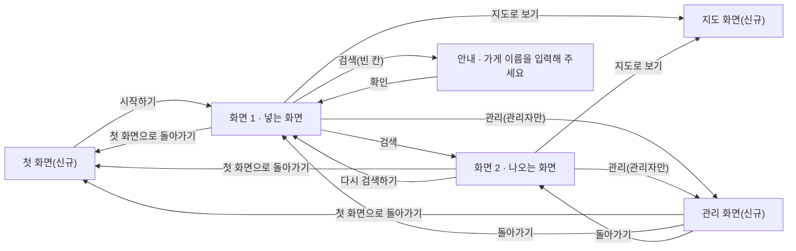

# PRD — 가게 이름으로 찾기

- 상태 : 완성
- 한 줄 정의 : 여행하며 현재 위치하고 있는 지역의 지도상에서 맛집을 골라 찾아갈 수 있는 서비스.

## 1. 문제

### 배경

- 누구 : 지역을 방문하는 여행객
- 언제 : 여행 전 목적지를 정하지 못하고, 돌아다니다가 갑자기 맛집을 정해야 할 때
- 왜 : 핸드폰 화면 하나로 여러 사이트를 검색하고 비교하기에 번거롭고 시간이 없어서
- 지금은 어떻게 하는가 : 일단 돌아다니면서 냄새로 판단하고, 네이버지도를 켜서 한 번 더 리뷰를 확인함

### 목표

마지막 발표에서 보여줄 장면(topic.md) : 현재 위치하고 있는 지역의 영업 중인 가게 범위 안에서 지역주민 및 다른 여행객들의 별점이 높은 음식점을 지도상에서 보여준다.

이를 위해 아래 두 가지 기능을 갖춘다.
1. 네이버 별점과 카카오 별점을 하나의 점수로 합쳐서 계산한다. (핵심)
2. 추천 결과를 지도 위에 표시한다.

## 2. 사용자

### 페르소나

- 누구인가 : 혼자 또는 친구와 함께 국내 소도시로 1~2박 여행을 다니는 32세 직장인 정하은
- 언제 서비스를 찾는가 : 여행 전 목적지를 정하지 못하고, 돌아다니다가 갑자기 맛집을 정해야 할 때
- 왜 불편한가 : 핸드폰 화면 하나로 여러 사이트들을 검색하고 비교하기에 번거롭고 시간이 없어서
- 지금은 어떻게 해결하는가 : 일단 돌아다니면서 냄새로 판단하고, 네이버지도를 켜서 한 번 더 리뷰를 확인함

### 사용자 스토리

- 여행객 정하은으로서, 네이버 별점과 카카오 별점을 하나의 점수로 합쳐서 보고 싶다. 두 앱을 번갈아 켜지 않고도 비교할 수 있기 때문이다.
- 여행객 정하은으로서, 추천 결과를 지도 위에 표시하고 싶다. 어느 방향으로 얼마나 걸어야 하는지 한눈에 볼 수 있기 때문이다.

## 3. 범위

### 넣을 기능

1. 네이버 별점과 카카오 별점을 하나의 점수로 합쳐서 계산한다. (핵심)
2. 추천 결과를 지도 위에 표시한다.
3. 구글·네이버·카카오 계정 가운데 하나로 들어와 내 이름이 보인다.
4. 관리자 메일로 들어오면 사이드바에 「관리」 버튼이 보이고, 누르면 관리 화면이 열린다.

### 기능 요구사항

**1. 통합 점수 계산**
- 가게 이름을 입력하고 "검색"을 누르면, 네이버 별점과 카카오 별점을 합친 통합 점수와 함께 지금 영업 중인 가게들의 이름이 세로 목록(예: 5~10개)으로 나온다.
- 입력을 비워 두고 "검색"을 누르면 "가게 이름을 입력해 주세요"라고 안내한다.
- 오타 등으로 없는 가게 이름을 넣으면 "'○○'라는 가게를 찾지 못했어요. 이름을 다시 확인해 주세요"라고 안내한다.
- "다시 검색하기"를 누르면 화면 1(넣는 화면)로 돌아간다.

**2. 지도 표시**
- 화면 1(넣는 화면) 또는 화면 2(나오는 화면)의 "지도로 보기" 버튼을 누르면, 가게 이름을 입력하지 않아도 현재 위치에서 반경 1.5km 이내에 있는 가게들이 지도 위에 표시된다. ("지도로 보기" 버튼은 wireframe.png에는 없던 버튼으로, 화면 1과 화면 2에 새로 추가하기로 함)
- 지도 화면에 "←" 모양 버튼을 두어, 누르면 뒤로 가는 기능을 한다.

### 비목표

- 여러 후보 가게를 체크해 리뷰수·별점·거리를 나란히 비교한다. — 제외 까닭 : scope.md에서도 한 번 뺐던 기능으로, 넣을 기능을 4개 이하로 유지하기 위해 이번 PRD에서 다시 뺀다.
- "지금 영업 중" 버튼을 눌러야만 영업 중인 가게만 따로 걸러서 보여준다. — 제외 까닭 : 검색 결과 자체가 실시간으로 영업 중인 가게만 보여주도록 개발할 예정이라, 버튼을 따로 눌러 걸러내는 절차가 필요 없어 뺀다.
- 메뉴 종류(한식/카페/고기 등)를 고르면, 그 메뉴 중에서 리뷰 좋은 가게만 추천받는다. — 제외 까닭 : 서비스는 별점·평점 중심으로 만들고, 리뷰(텍스트)는 서비스를 만들기 위한 참고용일 뿐 화면에 보이지 않게 하려는 방향이라, 리뷰 품질을 기준으로 메뉴를 필터링하는 기능은 방향에 맞지 않아 뺀다.
- 리뷰 문장에서 자주 나오는 표현(웨이팅, 친절함, 양 등)을 뽑아 요약하면, 리뷰를 하나하나 읽지 않고도 분위기를 파악할 수 있게 된다. — 제외 까닭 : 리뷰는 서비스를 만들기 위한 참고용일 뿐, 화면에 보이지 않게 하려는 방향이라 뺀다.
- 추천 가게를 누르면, 네이버·카카오 리뷰 원문 일부를 바로 볼 수 있어 다시 검색하지 않아도 된다. — 제외 까닭 : 추천 가게의 리뷰는 서비스를 만들기 위한 참고용일 뿐, 화면에 보이지 않게 하려는 방향이라 뺀다.

## 4. 화면

### 사용자 흐름

- 첫 화면(신규) : 서비스 이름과 한 줄 소개, 하는 일 세 가지를 보여 주고, 「시작하기」 버튼으로 화면 1에 갈 수 있는 화면. 화면 1·2의 사이드바에 있는 "첫 화면으로 돌아가기" 버튼으로 다시 올 수 있다 (wireframe.png에는 없던 화면으로, 새로 추가하기로 함)
- 화면 1 · 넣는 화면 : 가게 이름을 입력하고 검색하거나, 이름을 입력하지 않고 "지도로 보기" 버튼으로 지도 화면에 갈 수 있는 화면
- 화면 2 · 나오는 화면 : 영업 중인 가게들의 이름과 통합 점수 목록이 나오고, "지도로 보기" 버튼으로 지도 화면에 갈 수 있는 화면
- 지도 화면(신규) : 현재 위치에서 반경 1.5km 이내의 가게를 지도 위에 표시하는 화면 (wireframe.png에는 없던 화면으로, 새로 추가하기로 함)
- 관리 화면(신규) : 관리자에게만 보이는 화면 1·2 사이드바의 「관리」 버튼으로 갈 수 있고, 「관리자만 보는 화면입니다」 한 줄이 보이는 화면. 「돌아가기」 버튼으로 들어오기 전 화면(화면 1 또는 화면 2)에 돌아가고, 사이드바의 "첫 화면으로 돌아가기" 버튼으로 첫 화면에 갈 수 있다 (wireframe.png에는 없던 화면으로, 새로 추가하기로 함)

## 5. 완성 기준

### 수용 기준

- 가게 이름을 입력하고 검색하면, 네이버 별점과 카카오 별점이 하나로 합쳐진 통합 점수 목록이 나온다.
- 입력을 비워 두고 검색하면 "가게 이름을 입력해 주세요"라고 안내한다.
- 존재하지 않는 가게 이름으로 검색하면 "'○○'라는 가게를 찾지 못했어요. 이름을 다시 확인해 주세요"라고 안내한다.
- 화면 1에서 가게 이름을 입력하지 않고 "지도로 보기" 버튼을 누르면, 현재 위치에서 반경 1.5km 이내에 있는 가게들이 지도 위에 표시된다.
- 화면 2에서 "지도로 보기" 버튼을 누르면, 현재 위치에서 반경 1.5km 이내에 있는 가게들이 지도 위에 표시된다.
- 구글·네이버·카카오 계정 가운데 하나로 들어오면 화면 맨 위에 내 이름이 보인다.
- 관리자 메일로 들어오면 사이드바에 「관리」 버튼이 보이고, 누르면 「관리자만 보는 화면입니다」가 보인다. 관리자가 아니면 「관리」 버튼이 보이지 않고 관리 화면도 열리지 않는다.