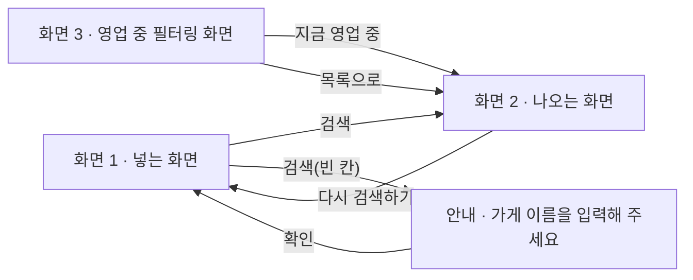

# 화면 흐름도

## 고친곳

- "지금 영업 중" 화살표 방향을 화면2 → 화면3에서 화면3 → 화면2로 고침 — wireframe.png에 이 버튼이 화면 2가 아니라 화면 3 안에 체크(✓)된 상태로 그려져 있어, 필터를 끄고 전체 목록(화면2)으로 돌아가는 버튼으로 보는 것이 그림과 맞기 때문
- 남은 문제 : 화면2 → 화면3으로 들어가는 버튼이 wireframe.png에 없어, 화면3으로 들어오는 화살표가 흐름도에 없음 (임의로 만들지 않음)
